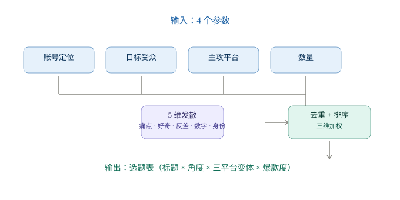
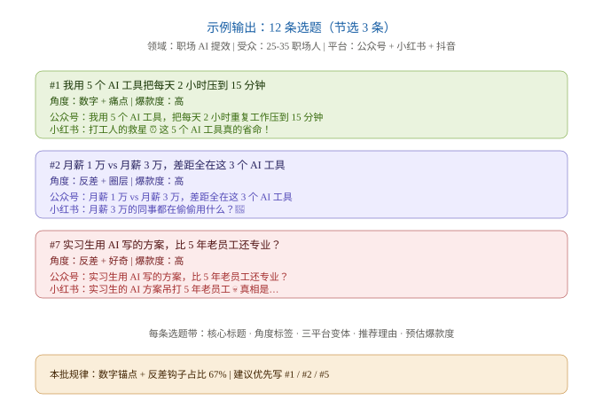

# Topic Idea Generator

> 输入一个领域，5 分钟拿到 30 条覆盖五个维度的爆款选题。

一款 WorkBuddy 技能，专为内容创作者设计。从账号定位出发，按 **痛点 / 好奇 / 反差 / 数字 / 身份** 五个维度发散，自动标注爆款基因、跨平台适配标题、按权重排序。



## 效果一览

输入一组参数，立即得到一张完整的选题表：



每条选题带：
- 核心标题
- 角度标签（5 维之一）
- 三平台标题变体（公众号 / 小红书 / 抖音）
- 推荐理由（爆款基因标签）
- 预估爆款度（高 / 中高 / 中 / 低）

## 适用人群

- **自媒体作者**：日更/周更卡选题时快速生成 30 条候选
- **品牌运营**：跨平台运营同一主题时一次拿全标题
- **内容团队**：每周选题会前生成选题池，按表分工
- **AI 写作者**：把选题表喂给下游写作 skill 直接成稿

## 快速开始

### 安装

下载 [`topic-idea-generator.zip`](./topic-idea-generator.zip)（已通过 WorkBuddy 官方校验器）。

在 WorkBuddy 中导入：

```
设置 → 技能管理 → 导入本地 Skill → 选择 zip
```

### 第一次使用

激活 skill 后会看到这段开场白：

```
你好，我是你的选题策划。
请告诉我：
1. 你的账号定位（领域 + 细分方向）
2. 目标受众（年龄/职业/痛点）
3. 主攻平台（公众号/小红书/抖音/B站/知乎，1-3 个）
4. 想要选题数量（默认 30）
```

按 4 项填好，30 秒内得到 30 条候选。

## 输入示例

| 项 | 值 |
|---|---|
| 账号定位 | 职场 AI 工具分享，主攻 AI 提效 |
| 目标受众 | 25-35 岁职场人，月薪 1-3 万，想提升效率、探索副业 |
| 主攻平台 | 公众号 + 小红书 + 抖音 |
| 数量 | 30 |

## 输出示例（节选）

| # | 选题 | 角度 | 公众号版 | 小红书版 | 抖音版 | 爆款度 |
|---|---|---|---|---|---|---|
| 1 | 我用 5 个 AI 工具把每天 2 小时压到 15 分钟 | 数字 + 痛点 | 我用 5 个 AI 工具… | 打工人的救星 ⏰… | 每天加班 2 小时？… | 高 |
| 2 | 月薪 1 万 vs 月薪 3 万差距全在这 3 个 AI 工具 | 反差 + 圈层 | 月薪 1 万 vs 月薪 3 万… | 月薪 3 万的同事…🤫 | 月薪 1 万和 3 万… | 高 |
| 7 | 实习生用 AI 写的方案比 5 年老员工还专业？ | 反差 + 好奇 | 实习生用 AI… | 实习生的 AI 方案吊打…💀 | 实习生方案比老员工还好？ | 高 |

完整 4 轮 demo 见 [`assets/demo-report.md`](./assets/demo-report.md)。

## 核心机制

### 5 维发散框架

每条选题必须归属至少 1 个维度：

| 维度 | 含义 | 典型句式 |
|---|---|---|
| **痛点** | 戳当下焦虑/卡住 | "为什么你总是…" |
| **好奇** | 反常识/悬念 | "X 居然不是 Y 干的" |
| **反差** | 对立面落差 | "月薪 1 万 vs 3 万" |
| **数字** | 具体锚点 | "我用 5 个工具…" |
| **身份** | 圈定人群 | "25-35 岁职场人…" |

### 8 种爆款基因

每条选题带 1-2 个基因标签：情绪共鸣 / 数字锚点 / 反差钩子 / 圈层身份 / 悬念反转 / 实用承诺 / 争议观点 / 热点借势。

### 三维加权排序

按 (维度覆盖数 × 爆款基因数 × 平台完整度) 自动排序，单维度不超过 40%。

## 跨领域复用示例

| 领域 | 输入 | 输出亮点 |
|---|---|---|
| 职场 AI 工具 | 25-35 职场人 | 数字 + 反差钩子占比 67% |
| 母婴育儿 | 新手爸妈 | 痛点 + 实用占比 70% |
| 美食探店 | 年轻女性 | 圈层 + 数字组合最强 |

## 与其他 skill 串联

```
topic-idea-generator (本 skill)
    ↓  选题表
viral-outline-generator (单条选题 → 完整大纲)
    ↓  大纲
content-writer (计划中)
    ↓  正文
```

仓库：https://github.com/YunHaiKong/viral-outline-generator

## 调整参数

拿到选题表后，常见追问指令：

- "把 #5-#10 改成更短标题" → 重新渲染
- "再加 20 条不同角度" → 重新发散
- "12 月底了，加跨年热点" → 季节词注入
- "小红书版再口语点" → 平台风格微调

## 文件结构

```
topic-idea-generator/
├── SKILL.md                                # 主入口
├── references/
│   └── topic-frameworks.md                 # 5 维发散 + 8 爆款基因（运行时加载）
├── assets/
│   ├── workflow.svg                        # 工作流图
│   ├── sample-output.svg                   # 输出示例图
│   └── demo-report.md                      # 完整 4 轮 demo 复盘
└── topic-idea-generator.zip                # 可分发包
```

## License

MIT
